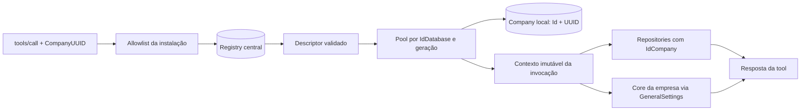

# Multi-tenancy central do MCP

## Modelo de identidade e isolamento

O MCP usa exclusivamente o Registry central para resolver empresas. Cada chamada de tool informa `CompanyUUID` em `_meta.ca.Execution`; o MCP normaliza e valida o UUID, aplica a allowlist da instalação e resolve no Registry a empresa e o descriptor da base. Não há fallback para `DB_*`, banco padrão ou conexão escolhida pela chamada.

`CompanyUUID` identifica a empresa. `IdDatabase` identifica a base e a geração do pool compartilhado. `IdCompany` continua sendo o escopo de negócio local. Empresas diferentes na mesma base compartilham o pool, mas cada consulta conserva seu `IdCompany`. Quando a chamada informa `IdCompany` ou `IdDatabase`, esses valores servem apenas para conferir consistência com o Registry.

O descriptor central é lido de `Company` relacionado a `Databases` e validado antes de abrir uma conexão. A identidade também é conferida na tabela local `Company` usando o ID e o UUID. Credenciais e handles de conexão permanecem na camada de infraestrutura; tools recebem apenas uma identidade imutável e serviços com escopo daquela invocação.



O histórico é limitado pela relação `Message → Chat → Channel.IdCompany`. O estado do Flow é limitado por `ProcessLineFlow → ProcessLine → CompanyModule.IdCompany`. As consultas ERP continuam filtrando `IdCompany`. Flow e Navigation carregam o endereço `MSG4COREAPI` das `GeneralSettings` da empresa somente quando uma dessas tools é usada. A ausência dessa configuração não bloqueia consultas SQL.

Pools são compartilhados por `IdDatabase`. Criações concorrentes da mesma configuração usam uma única conexão inicializada. Uma rotação publica uma nova geração e mantém a anterior aberta até terminar o uso em andamento. A capacidade é limitada; pools ociosos podem ser fechados, mas pools com invocações ativas não são removidos por expiração.

## Metadata MCP

Todas as onze tools exigem `CompanyUUID` no metadata técnico, fora dos argumentos funcionais:

```json
{
  "_meta": {
    "ca": {
      "Execution": {
        "CompanyUUID": "550e8400-e29b-41d4-a716-446655440000",
        "IdCompany": 1,
        "ExecutionUUID": "identificador-da-execucao",
        "TurnUUID": "identificador-do-turn",
        "IdProcessLine": 100
      }
    }
  }
}
```

Cada tool mantém os outros campos técnicos obrigatórios que já possui. `IdCompany` informado deve coincidir com o Registry; `IdDatabase`, quando presente como dado de consistência, não seleciona a conexão. `initialize` e `tools/list` continuam independentes de empresa. Os corpos enviados ao Core mantêm seus contratos existentes e não recebem automaticamente os campos de roteamento.

O AgentRuntime precisa incluir `CompanyUUID` em **cada `tools/call` MCP**, não apenas na inicialização do transporte. Esse ajuste no consumidor é pré-requisito para ativar a primeira release central; este repositório não altera o AgentRuntime nem o Core.

## Configuração

| Variável | Padrão / regra | Uso |
|---|---:|---|
| `PORT` | `3102` | Porta HTTP |
| `NODE_ENV` | `development` | Ambiente de execução |
| `CENTRAL_DB_HOST` | obrigatória | Host do Registry |
| `CENTRAL_DB_PORT` | `3306` | Porta do Registry |
| `CENTRAL_DB_NAME` | obrigatória | Banco do Registry |
| `CENTRAL_DB_USER` | obrigatória | Usuário de leitura do Registry |
| `CENTRAL_DB_PASS` | obrigatória | Senha do Registry |
| `CENTRAL_DB_CONNECTION_LIMIT` | `4` | Limite do pool do Registry |
| `CENTRAL_REGISTRY_CACHE_MS` | `60000` | Cache da resolução |
| `TENANT_DB_CONNECTION_LIMIT` | `8` | Conexões por pool de empresa/base |
| `TENANT_DB_CONNECT_TIMEOUT_MS` | `10000` | Timeout de conexão às bases |
| `TENANT_DB_MAX_POOLS` | `32` | Capacidade máxima de pools |
| `TENANT_DB_IDLE_TTL_MS` | `300000` | Retenção de pool sem uso |
| `CORE_API_TIMEOUT_MS` | `60000` | Timeout de chamadas ao Core |
| `MCP_CORE_SETTINGS_CACHE_MS` | `60000` | Cache de configuração do Core |
| `MCP_SHUTDOWN_TIMEOUT_MS` | `75000` | Prazo de drenagem no encerramento |
| `MCP_TENANT_ALLOWLIST` | obrigatória e não vazia em produção | UUIDs atendidos, separados por vírgula |

A allowlist restringe quais empresas uma instalação atende. Ela não autentica o chamador. As variáveis globais `DB_*` e `CORE_API_URL` não configuram mais o runtime. O teste opt-in contra Core real usa configuração de teste própria.

## Health, disponibilidade e limites operacionais

`/health` permanece como liveness compatível; `/health/live` informa liveness e `/health/ready` verifica inicialização, Registry e estado de drenagem. Uma base de empresa indisponível afeta as chamadas dessa empresa, sem retirar a instalação inteira de readiness.

No SIGTERM, o processo deixa de aceitar novas tools, espera as invocações em andamento até o prazo configurado e encerra pools e Registry. Logs de execução identificam a empresa, a base e os IDs de correlação disponíveis, sem credenciais, SQL bruto ou payloads de negócio.

Esta etapa não adiciona autenticação às APIs, roteamento de banco por requisição do consumidor nem coordenação distribuída entre réplicas. O Registry central e os pools são gerenciados por processo; a operação planejada usa uma instância do MCP. Não são criadas migrations produtivas para as bases do Registry ou das empresas.

## Testes SQL

`npm run test:database` é uma suíte opt-in contra MariaDB 11.8.6. Ela exige `MCP_TEST_DB_HOST`, `MCP_TEST_DB_PORT`, `MCP_TEST_DB_USER` e `MCP_TEST_DB_PASSWORD`, além da confirmação explícita `MCP_TEST_DB_ALLOW_CREATE_DROP=YES`. O runner aceita somente `localhost`, loopback ou o alias local `mariadb`, cria schemas temporários aleatórios e apaga exclusivamente os nomes que ele próprio criou. A suíte padrão não lê essas variáveis nem exige banco. Use uma instância MariaDB efêmera/local e uma credencial de teste com permissões limitadas de criação e remoção de schemas.
